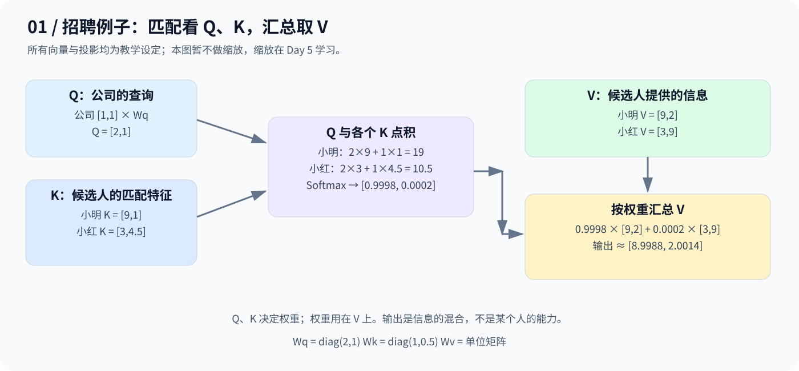
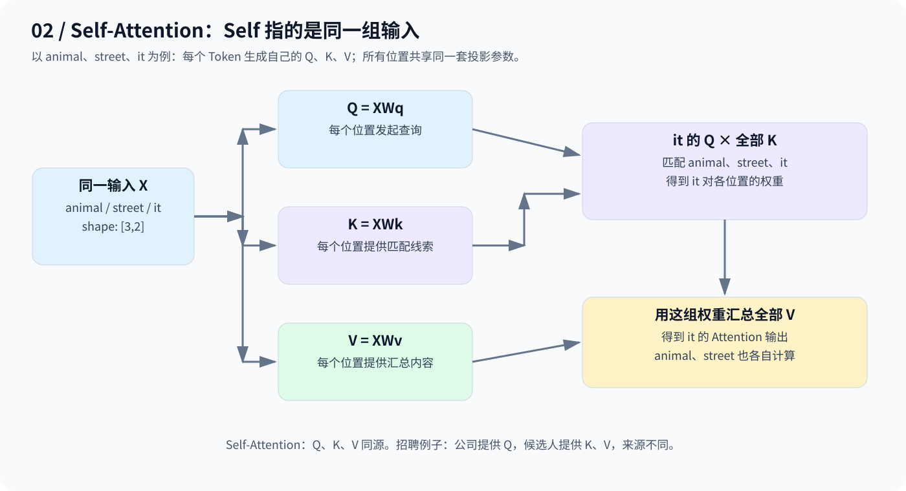
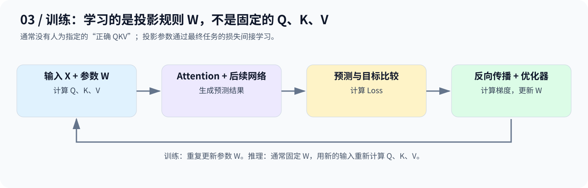

# Day 4：Q、K、V——先匹配，再汇总

> Q 表达查询，K 提供匹配线索，V 提供被汇总的信息。三张图串起招聘例子、Self-Attention 和参数训练。

## 1. 从招聘例子理解三个角色

公司招聘工程师，用二维向量表示编程与英语能力：

| 对象 | 原始向量 |
|---|---|
| 公司需求 | `[1,1]` |
| 小明 | `[9,2]` |
| 小红 | `[3,9]` |

直接点积会得到 `[11,12]`，Softmax 后更关注小红。但公司可能更看重编程，因此先用矩阵调整匹配特征：

```text
Wq = [[2,0], [0,1]]     公司 → Q = [2,1]
Wk = [[1,0], [0,0.5]]   小明 → K = [9,1]；小红 → K = [3,4.5]
Wv = [[1,0], [0,1]]     小明 → V = [9,2]；小红 → V = [3,9]
```



| 角色 | 招聘直觉 | 专业含义 |
|---|---|---|
| Q：Query | 公司想找什么？ | 查询方用于匹配的向量 |
| K：Key | 候选人有什么匹配线索？ | 被查询方提供的匹配向量 |
| V：Value | 最终要汇总什么信息？ | 按注意力权重汇总的内容向量 |

**Q、K 决定关注权重，V 决定汇总内容。** 匹配特征与传递内容可以采用不同的投影；本例为了手算方便，让 V 保持原向量。

### 一次完整计算

```text
Q · K_小明 = 2×9 + 1×1   = 19
Q · K_小红 = 2×3 + 1×4.5 = 10.5

softmax([19,10.5]) ≈ [0.9998, 0.0002]
output ≈ [8.9988, 2.0014]
```

输出按未舍入的权重计算。它是两份 V 的加权混合，并不是某个候选人的真实能力。本日暂不除以缩放因子，Day 5 再加入。

上述矩阵和能力含义都是教学设定；真实向量的每一维不保证有清晰的人类语义。投影只能重新组合已有特征，不能凭空获得输入中不存在的工作经历等信息。

## 2. 投影矩阵与 Q/K/V 有什么区别？

对于同一输入 X，三套投影生成三种表示：

$$
Q=XW_Q,\qquad K=XW_K,\qquad V=XW_V
$$

- **W 是可学习的参数**：决定如何投影；同一层的各个 Token 共享相应的 W。
- **Q、K、V 是本次输入的计算结果**：输入改变，它们也会改变。
- 三套矩阵分别学习，让“如何匹配”和“传递什么”有不同的表达空间。

招聘例子中来源不同，应分别写成：公司输入生成 Q，候选人输入生成 K、V；不能把它们都当成同一个 X。

## 3. Self-Attention：Self 指“来自同一输入”

招聘例子里，公司查询候选人，查询方与信息提供方不同。Self-Attention 则让**同一序列的每个 Token 同时扮演两种角色**。



以 `animal / street / it` 为例：`it` 的 Q 匹配允许访问位置的 K，再用所得权重汇总这些位置的 V；其他 Token 也各自计算。

**Self 由输入来源决定，并不是“加入 QKV 后才叫 Self-Attention”。** Day 3 直接使用原始向量的例子也可以看作简化版本；Day 4 加入可训练投影，让匹配与表示更加灵活。

## 4. Wq、Wk、Wv 怎么学出来？



投影矩阵通常随机初始化，模型根据预测与目标的误差，通过反向传播计算梯度，再由优化器更新参数。**通常没有人为指定的“正确 QKV”，它们通过最终任务间接学习。**

推理时一般固定 W，但会随新输入重新计算 Q、K、V。

## 5. 对应当天代码

[code.py](code.py) 保留原始 `animal / street / it` 练习，手工指定 W，演示投影、点积、Softmax 和汇总，未进行参数训练。它只让 `it` 查询 `animal`、`street`，尚未实现图中全部位置的完整 Self-Attention。

| 步骤 | 对应代码与结果 |
|---|---|
| 生成查询 | `Q_it = it @ Wq` → `[0.8,0.4]` |
| 生成匹配向量 | `K_animal = animal @ Wk` → `[2,0]`；`K_street` → `[0,1]` |
| 计算分数 | `torch.dot(Q_it, K_...)` → `[1.6,0.4]` |
| 转成权重 | `torch.softmax(scores, dim=0)` → 约 `[0.7685,0.2315]` |
| 汇总 V | 两个 V 分别为 `[1,1]`、`[0,1]`，输出约 `[0.7685,1.0000]` |

这里与招聘例子使用不同向量和矩阵，但计算逻辑一致。`torch.stack()` 将两个标量分数组成 `[2]` 张量；两个二维 V 加权相加后仍为 `[2]`。

从仓库根目录运行（需安装 PyTorch）：

```bash
python day04/code.py
```

表中数值由计算推导，尚未在此环境执行脚本验证。该输出是 Attention 子步骤的结果，不是整个 Transformer Block 的最终表示。

## 6. 记住这三点

1. **Q/K 匹配，V 汇总**：先决定权重，再传递信息。
2. **W 是参数，QKV 是结果**：训练更新投影规则，输入决定本次向量。
3. **Self 指同源**：同一组输入同时生成 Q、K、V。

下一步 Day 5：加入缩放因子，并用矩阵乘法一次计算多个位置的注意力。

---

[返回学习导航](../README.md)
