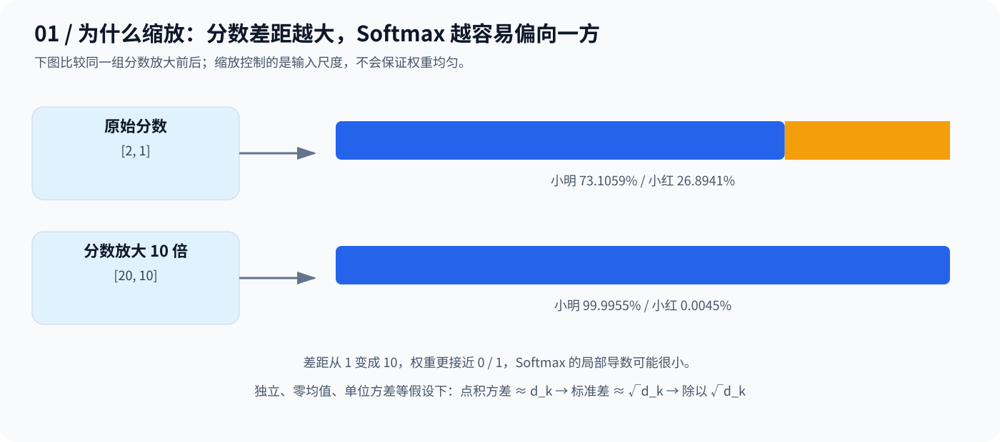
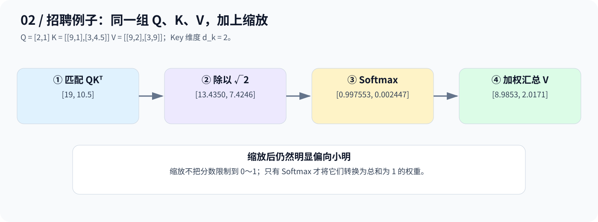
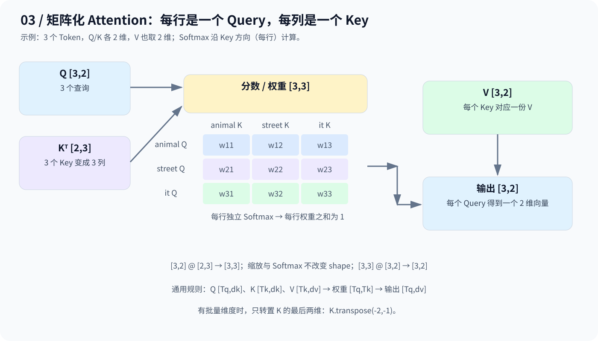

# Day 5：Scaled Dot-Product Attention——缩放与矩阵化

> 在 Day 4 的 QKV 基础上，增加两件事：用缩放控制分数尺度，用矩阵乘法同时计算多个位置。

## 1. 为什么要缩放？先看 Softmax

仍把两个分数看作公司对小明、小红的匹配评价：



从 `[2,1]` 到 `[20,10]`，排序没变，但分数差距被放大，权重变得更极端。**Softmax 在接近 0、1 时，其局部导数可能很小，不利于梯度传递。**

这不意味着注意力必须平均分配，而是要避免分数仅因维度增加就过早饱和。决定 Softmax 分布的是分数之间的相对差异；给所有分数加同一个常数不会改变权重。

### 为什么除以 √d_k，而不是 d_k？

点积是多个乘积项的和：

$$
q\cdot k=\sum_{i=1}^{d_k}q_i k_i
$$

若各分量独立、均值为 0、方差为 1，且乘积项之间独立：

$$
\mathrm{Var}(q\cdot k)=d_k,
\qquad
\mathrm{Std}(q\cdot k)=\sqrt{d_k}
$$

因此除以标准差尺度，使缩放后方差为 1；若除以 d_k，方差会变成 `1/d_k`，随维度增大而过小。这是常见统计假设下的解释，不保证真实模型严格满足这些假设。

**d_k 是参与点积的 Q/K 向量维度，不是 Token 数量。** 缩放因子由维度决定，不是可训练参数，也不把分数限定到 0～1。

## 2. 招聘例子：把缩放真正算进去

沿用 Day 4：

```text
Q = [2,1]
K = [[9,1], [3,4.5]]
V = [[9,2], [3,9]]
```



因为 `d_k=2`，完整计算是：

```text
原始分数：  [19, 10.5]
缩放后：    [13.4350, 7.4246]
权重：      [0.997553, 0.002447]
加权汇总 V：[8.9853, 2.0171]
```

结果按未舍入的中间值计算。与 Day 4 不缩放时相比，权重没那么极端，但仍明显偏向小明。输出是信息的加权混合，不是某个候选人的原始向量。

## 3. 为什么用 QKᵀ？一次完成所有点积

K 的每一行是一份候选特征；转置后，每一列对应一个 Key。于是 Q 与这些列相乘，就一次得到对所有 Key 的分数：

$$
[2,1]
\begin{bmatrix}9&3\\1&4.5\end{bmatrix}
=[19,10.5]
$$

招聘例子只有一个 Q。Self-Attention 则让每个 Token 都生成 Q，一次算出全部位置的匹配关系：



| 步骤 | 3 个 Token、每个向量 2 维的示例 |
|---|---|
| 匹配分数 `Q @ K.T` | `[3,2] @ [2,3] → [3,3]` |
| 除以 √d_k | `[3,3] → [3,3]` |
| Softmax（最后一维） | 每个 Query 对应一行，每行权重之和为 1 |
| 汇总 `weights @ V` | `[3,3] @ [3,2] → [3,2]` |

**分数矩阵的行是 Query，列是 Key。** Key 的数量必须与 Value 的数量一致；V 的特征维度可以与 Q/K 不同。

## 4. 公式与代码对应

$$
\mathrm{Attention}(Q,K,V)
=\mathrm{softmax}\left(\frac{QK^\top}{\sqrt{d_k}}\right)V
$$

[code.py](code.py) 保留原始招聘练习，核心是：

```python
scores = Q @ K.T
d_k = K.shape[-1]
scaled_scores = scores / math.sqrt(d_k)
weights = torch.softmax(scaled_scores, dim=-1)
output = weights @ V
```

当前代码的 Q 是一维 `[2]`，因此分数和输出均为 `[2]`。图中的 `[3,3]` 分数矩阵展示的是多个 Query 的扩展，并非此脚本当前的输入。

对于二维或带 Batch 的输入，使用 `K.transpose(-2,-1)` 只交换最后两维；不要用 `.T` 翻转高维张量的所有维度。通用形状为：

```text
Q: [..., Tq, dk]     K: [..., Tk, dk]     V: [..., Tk, dv]
scores / weights: [..., Tq, Tk]          output: [..., Tq, dv]
```

其中前导 Batch 维度需兼容。`softmax(dim=-1)` 沿 Key 位置归一化；若需要因果 Mask，应在 Softmax 前屏蔽不允许访问的位置，后续课程再展开。

从仓库根目录运行（需安装 PyTorch）：

```bash
python day05/code.py
```

上方结果已按数学计算核对，尚未在此环境执行 PyTorch 脚本。现有代码是单 Query 演示，尚未封装通用函数或加入 Mask。

## 5. 记住三点

1. **缩放**：控制点积分数的典型波动尺度，缓解 Softmax 过度饱和。
2. **矩阵化**：QKᵀ 同时计算全部查询与键的匹配关系；每行独立 Softmax。
3. **汇总**：权重乘 V，得到每个 Query 对应的输出向量。

下一步 Day 6：多个 Head 在不同的投影空间中，分别执行这套计算。

---

[返回学习导航](../README.md)
