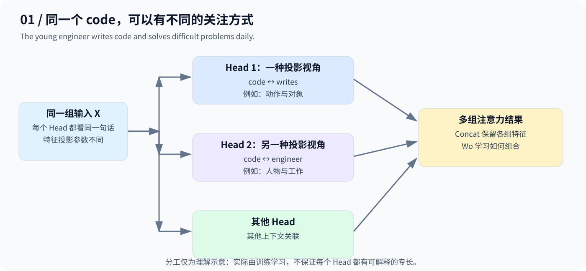
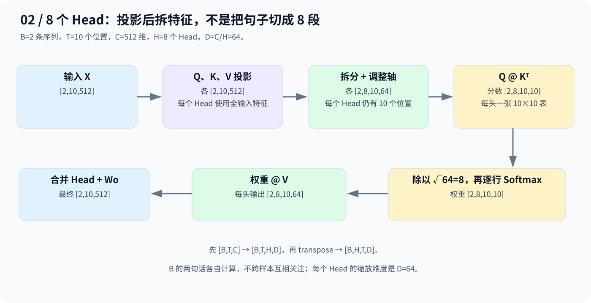
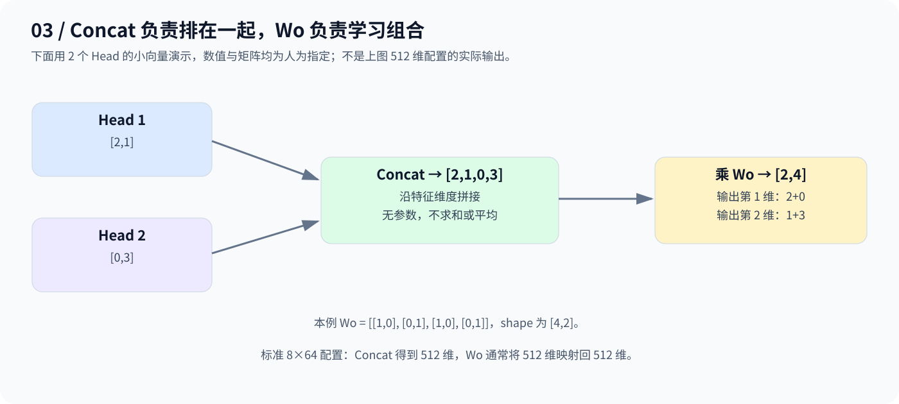

# Day 6：Multi-Head Attention——多种视角，拼接再融合

> 同一输入 → 不同 QKV 投影 → 每个 Head 独立计算 Attention → Concat → 输出投影。

## 1. 为什么需要多头？从 code 看不同关系

沿用两条示例句子，按词切分并忽略末尾标点，每句 10 个 Token：

> The young engineer writes code and solves difficult problems daily.
>
> The experienced developer reviews code and improves the system performance.

关注第一句的 `code` 时，既可能需要 `writes` 的动作信息，也可能需要 `engineer` 的人物信息。



单头能同时关注多个 Token，但对同一 Query 只有一组注意力权重。多头通过**不同的可训练投影，在多个表示子空间中学习关注方式**。图中分工只是理解示意，实际由训练学习，不保证每头都有固定、可解释的职责。

### 用之前的招聘例子复习

公司 `[1,1]`，小明 `[9,2]`，小红 `[3,9]`。人为让一头取编程维度，另一头取英语维度，各自用同样的规则生成 Q/K/V：

| Head | 投影列向量 | 匹配分数 | Softmax 权重 | 汇总结果 |
|---|---|---|---|---:|
| 编程视角 | `[1,0]ᵀ` | `[9,3]` | 约 `[0.9975,0.0025]` | 8.985 |
| 英语视角 | `[0,1]ᵀ` | `[2,9]` | 约 `[0.0009,0.9991]` | 8.994 |

每头 Key 维度为 1，缩放因子也是 1。拼接得 `[8.985,8.994]`，保留了两个视角的信息，不代表某个人同时拥有这两项能力。真实 Self-Attention 则让查询和信息提供方来自同一序列。

## 2. 多头“多”在参数，不是复制输入

设 `B=2、T=10、C=512、H=8`，每头维度 `D=C/H=64`。



先用全输入特征生成 Q/K/V，再拆分投影后的特征维度：

```text
[B,T,C] → [B,T,H,D] → [B,H,T,D]
```

**每个 Head 都能使用输入的全部 512 维来生成自己的 64 维投影。** 不是把原始输入直接切成互不相见的 8 块，也不是把 10 个 Token 切成 8 段。

| 步骤 | 本例 Shape |
|---|---|
| 输入 X | `[2,10,512]` |
| Q、K、V 投影 | 各 `[2,10,512]` |
| 拆头并调整维度顺序 | 各 `[2,8,10,64]` |
| QKᵀ、缩放、Softmax | `[2,8,10,10]` |
| 权重乘 V | `[2,8,10,64]` |
| 合并头、输出投影 | `[2,10,512]` |

每个 Head 使用自己的 Q/K/V 计算 Attention，沿 Key 位置做 Softmax；缩放除以 `√64=8`，不是 `√512`。Batch 中的两句话各自计算，不跨样本互相关注。

## 3. 为什么 Concat 后还要 Wo？



- **Concat**：沿特征维度排在一起，没有参数，不求和或平均。
- **Wo**：可训练的输出投影，对不同 Head 的特征做线性组合。

图中用两份小向量 `[2,1]`、`[0,3]` 演示，拼接得到 `[2,1,0,3]`，再乘人为指定的 `[4,2]` 矩阵得到 `[2,4]`。标准本例则是 `8×64=512`，Wo 通常将 512 维映射回 512 维。

合并头时要先把 Token 轴移回 Head 轴前面：

```python
# out: [B,H,T,D]
out = out.transpose(1, 2).contiguous().view(B, T, C)
output = out_proj(out)
```

直接跳过 `transpose` 做 `view(B,T,C)` 会弄乱位置与 Head 的对应关系。

## 4. 公式与工程实现对应

为避免重复投影，这里始终以原始输入 X 表达 Self-Attention：

$$
Q_i=XW_i^Q,\qquad K_i=XW_i^K,\qquad V_i=XW_i^V
$$

$$
\mathrm{head}_i
=\mathrm{softmax}\left(\frac{Q_iK_i^\top}{\sqrt{D}}\right)V_i
$$

$$
\mathrm{MultiHead}(X)
=\mathrm{Concat}(\mathrm{head}_1,\ldots,\mathrm{head}_H)W^O
$$

本例每头投影矩阵为 `[512,64]`，拼接后的输出矩阵为 `[512,512]`；公式省略偏置。

工程中可合并为一次大投影：

```python
qkv = qkv_proj(x)                 # Linear(512,1536)：[B,T,1536]
q, k, v = qkv.chunk(3, dim=-1)   # 各 [B,T,512]
q = q.view(B, T, H, D).transpose(1, 2)
# k、v 采用同样的拆头步骤，随后各头并行计算 Attention
```

参数对应一致时，这与分别计算各头的 Q/K/V 数学等价；`reshape` 本身没有创造新的投影参数。

## 5. 常见误区与当天代码

| 问题 | 要点 |
|---|---|
| 多头是 8 个完全独立模型吗？ | 是同一模块里的不同投影分支，共同训练，最后融合 |
| 同参数的两头会产生不同结果吗？ | 输入、Mask 等条件相同且无随机因素时，结果相同 |
| 头越多越好吗？ | 不一定；固定 C 时，每头 D 会更小，需要权衡 |
| 多头天然知道顺序吗？ | 标准未加位置机制的 Self-Attention 不内置位置信息，Day 7 再补充 |

[code.py](code.py) 继续留空，待补充当天实际实现。上方代码片段只用于解释维度操作，不代表已经提交了完整可运行模块。

## 6. 记住三点

1. **多头**：用不同投影学习不同的注意力模式。
2. **拼接**：将每头结果沿特征维度放在一起。
3. **输出投影**：学习如何组合拼接后的特征。

---

[返回学习导航](../README.md)
