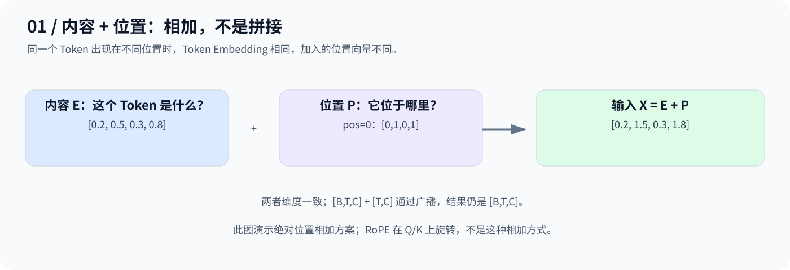
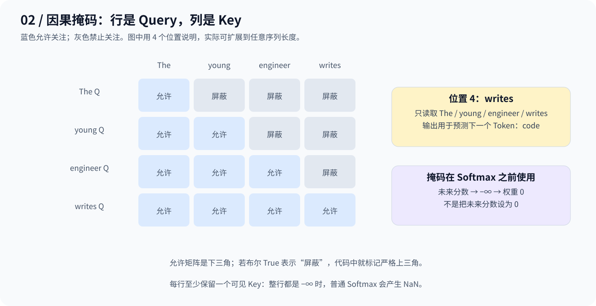
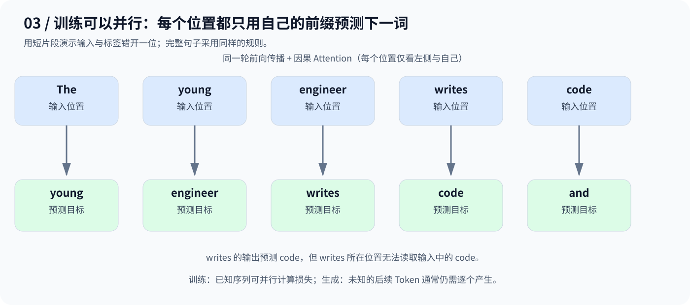

# Day 7：Position + Mask——在哪里，能看哪里

> Position 提供位置信息；Mask 限制信息流向。它们解决的是两个不同的问题。

## 1. 为什么需要位置编码？

沿用 `The young engineer writes code ...`：`code` 在第 5 个位置，但它的 Token Embedding 本身不说明“第几个”。标准未加位置机制、也未加 Mask 的 Self-Attention 不自带顺序信息；交换输入位置会相应交换输出，不能凭空识别绝对位置。

一种做法是给每个位置一个向量，与 Token 向量相加：

$$
X=E+P
$$



例如 `E=[0.2,0.5,0.3,0.8]`、`P=[0,1,0,1]`，相加得到 `[0.2,1.5,0.3,1.8]`。两者必须同维，模型通过训练学习利用融合后的信息。

## 2. 正弦位置编码如何计算？

原始 Transformer 用不同频率的 sin/cos 生成固定向量，无需训练位置参数：

$$
PE(pos,2i)=\sin\left(\frac{pos}{10000^{2i/d_{\mathrm{model}}}}\right)
$$

$$
PE(pos,2i+1)=\cos\left(\frac{pos}{10000^{2i/d_{\mathrm{model}}}}\right)
$$

`pos` 是位置编号，`i` 是频率组编号；这里均从 0 开始，偶数维用 sin，奇数维用 cos。

当 `d_model=4`：

```text
PE(pos) = [sin(pos), cos(pos), sin(pos/100), cos(pos/100)]
PE(0)   = [0, 1, 0, 1]
PE(1)   ≈ [0.84147, 0.54030, 0.01000, 0.99995]
```

| 方案 | 位置如何进入模型 |
|---|---|
| 固定正弦位置编码 | 用公式计算位置向量，再与 Embedding 相加 |
| 可学习绝对位置编码 | 查可训练的位置参数表，再与 Embedding 相加 |
| RoPE | 按位置旋转 Q/K 的特征对，让分数体现相对位置；不是给 Embedding 加向量 |

## 3. Causal Mask：不能提前看到答案

用前缀 `The young engineer writes` 预测 `code` 时，`writes` 所在位置只能读取前四个 Token，不能读取输入中后面的 `code`。



图中行是 Query、列是 Key。若 `1=允许`、`0=禁止`，长度 4 的矩阵是：

$$
\begin{bmatrix}
1&0&0&0\\
1&1&0&0\\
1&1&1&0\\
1&1&1&1
\end{bmatrix}
$$

**在 Softmax 前，把禁止位置的分数设为负无穷。** 因为指数值趋于 0，屏蔽位置最终权重为 0，其余位置重新归一化。

```text
某行分数：[2, 1, 3, 4]
若只允许前两列：
加 Mask → [2, 1, -∞, -∞]
Softmax → [0.7311, 0.2689, 0, 0]
```

把分数设为 `0` 不等于屏蔽，因为 `exp(0)=1`。也要避免整行全被屏蔽，否则普通 Softmax 会产生 NaN。

## 4. 广播与 API：先分清 True 的含义

沿用 `B=2、T=10、C=512、H=8、D=64`：

| 内容 | Shape |
|---|---|
| Token Embedding | `[2,10,512]` |
| 位置编码 | `[10,512]` 或 `[1,10,512]` |
| 相加后的 X | `[2,10,512]` |
| 拆头后的 Q/K/V | 各 `[2,8,10,64]` |
| 分数与权重 | `[2,8,10,10]` |
| 因果 Mask | `[10,10]`，广播到所有 Batch 和 Head |

若用 `masked_fill`，可将布尔 `True` 定义为“禁止”：

```python
future_mask = torch.triu(
    torch.ones(T, T, dtype=torch.bool, device=scores.device),
    diagonal=1,
)
scores = scores.masked_fill(future_mask, float("-inf"))
weights = torch.softmax(scores, dim=-1)
```

这里标记严格上三角，即未来位置。**不要把布尔 Mask 原样套到所有 API**：`nn.MultiheadAttention` 的布尔 `attn_mask=True` 表示禁止，而 `F.scaled_dot_product_attention` 的布尔 `attn_mask=True` 表示允许。

上面的 `[T,T]` 广播说明针对手写 Attention；具体封装 API 的 Mask 形状要求仍需按接口核对。

## 5. 不看未来，为什么训练还能并行？



训练时序列已知，可以把输入和标签错开一位：

```text
输入：The   young      engineer   writes   code
目标：young engineer   writes     code     and
```

各位置在同一轮前向传播中计算，**每一层的因果 Attention 都限制其可见前缀**。`writes` 输出预测 `code`，但无法从后面的输入位置读取它；损失计算也需正确对齐标签。

因此，训练时“输入里有未来 Token”与“当前位置能够读取未来”是两回事。生成时未来 Token 尚未知，通常仍需自回归地逐个生成。

## 6. 总结与当天代码

| 机制 | 做什么 | 本日对应操作 |
|---|---|---|
| Position | 提供位置线索 | 内容向量与位置向量相加 |
| Causal Mask | 禁止读取未来 | Softmax 前将未来分数设为负无穷 |

本日完整路径：`E+P → QKV → QKᵀ/√D → Mask → Softmax → 汇总 V`。

[code.py](code.py) 继续留空，待补充实际练习；上方片段用于说明 Mask 操作，不是完整可运行脚本。

**Position 说明在哪里，Mask 规定能看哪里。**

---

[返回学习导航](../README.md)
