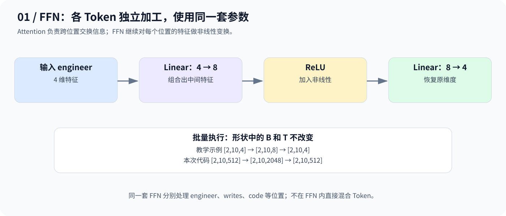
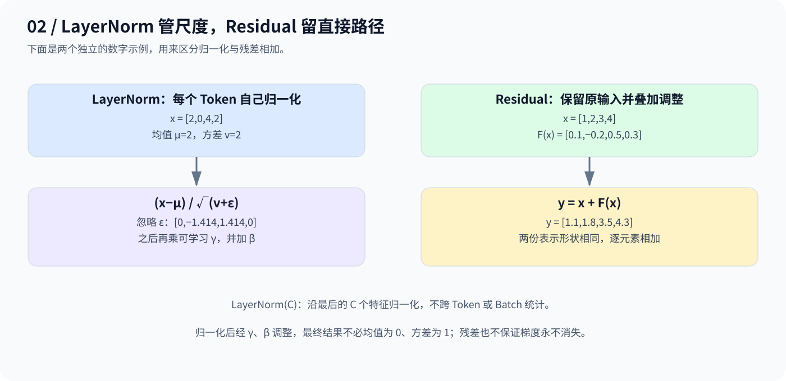
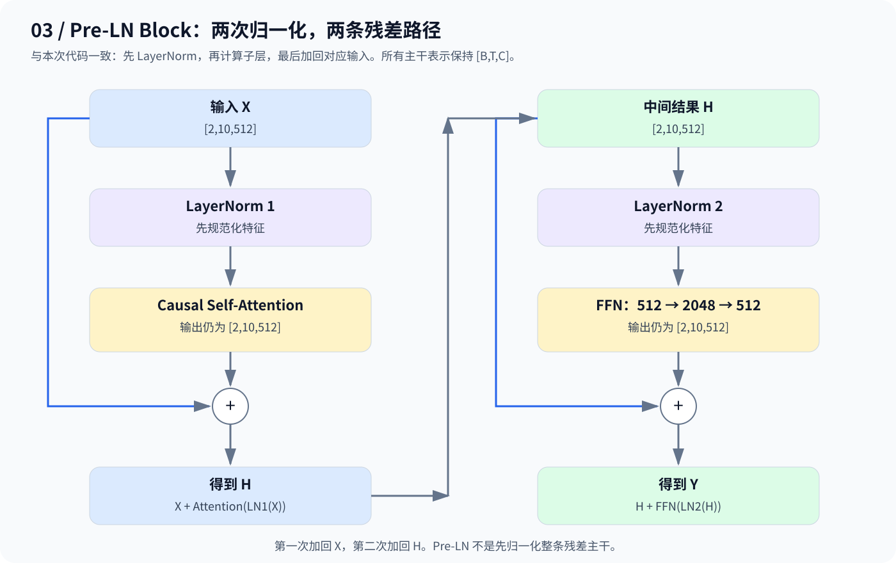

# Day 8：FFN、Residual、LayerNorm——组装 Transformer Block

> Attention 交换上下文，FFN 加工特征，Residual 提供直接路径，LayerNorm 帮助稳定数值尺度。

## 1. Attention 之后还缺什么？

在 `The young engineer writes code ...` 中，`engineer` 通过 Attention 融合了允许访问位置的上下文；使用因果 Mask 时，它不能读取后面的 `writes`、`code`。

模型还需要加工融合后的特征，并让多层网络更容易训练。因此，一个 Block 不只包含 Attention。

## 2. FFN：对每个 Token 做非线性加工

把一个 Token 的 4 维表示先扩展到 8 维，经过激活函数，再映射回 4 维：



用行向量右乘矩阵的记法：

$$
\mathrm{FFN}(x)=\sigma(xW_1+b_1)W_2+b_2
$$

高维中间层配合非线性激活增强表达能力；若去掉激活，两层仿射变换仍可合并成一层。最后恢复到 C 维，便于残差相加。

**每个 Token 独立处理，但共享同一套 FFN 参数。** FFN 本身不在位置之间交换信息。本次代码采用 `Linear(512,2048) → ReLU → Linear(2048,512)`。

## 3. Residual 与 LayerNorm：做的不是同一件事



### Residual：原表示 + 调整量

例如 `x=[1,2,3,4]`，子层输出 `F(x)=[0.1,-0.2,0.5,0.3]`，则：

$$
y=x+F(x)=[1.1,1.8,3.5,4.3]
$$

残差提供直接的信息和梯度路径，让子层学习在原表示上的调整；并不保证所有训练问题都消失。本 Block 中相加的两份表示均为 `[B,T,C]`。

### LayerNorm：沿单个 Token 的特征维度归一化

对于 `x=[2,0,4,2]`，均值为 2，方差为 2。忽略很小的 ε，标准化得到 `[0,-1.414,1.414,0]`，完整计算再加入可学习缩放与偏移：

$$
\mathrm{LN}(x)=\gamma\odot\frac{x-\mu}{\sqrt{v+\epsilon}}+\beta
$$

`nn.LayerNorm(C)` 在每个 Token 的 C 个特征上独立计算，**不跨 Batch、不跨 Token**，shape 不变。加入 γ、β 后，最终输出不必保持零均值、单位方差。

## 4. Pre-LN Transformer Block：两条残差接在哪里？



$$
H=X+\mathrm{Attention}(\mathrm{LN}_1(X))
$$

$$
Y=H+\mathrm{FFN}(\mathrm{LN}_2(H))
$$

第一次残差加回 X，第二次加回中间结果 H。LN 位于子层前，直接残差路径保留未经该 LN 处理的输入。

| 结构 | 单个子层的顺序 |
|---|---|
| Pre-LN（本次实现） | LN → 子层 → 与输入相加 |
| Post-LN（原版 Transformer） | 子层 → 与输入相加 → LN |

许多 GPT 类模型采用 Pre-LN；具体模型可能使用不同的归一化及激活方案。

## 5. 当天代码与验证范围

[code.py](code.py) 是本次提供的完整实现，包含 `CausalSelfAttention`、`FeedForward` 和 `TransformerBlock`。Attention 已有输出投影；本 Block 没有加入 Dropout，也不包含 Embedding、位置编码或 LM Head。

| 部分 | 代码中的 Shape |
|---|---|
| 输入 / 两次 LN / 两次残差 / Block 输出 | `[2,10,512]` |
| 合并 QKV 投影 | `[2,10,1536]` |
| 拆头后的 Q/K/V | 各 `[2,8,10,64]` |
| 注意力权重 | `[2,8,10,10]` |
| FFN 中间表示 | `[2,10,2048]` |

从仓库根目录运行（需安装 PyTorch）：

```bash
python day08/code.py
```

脚本使用随机张量模拟两条输入序列，预期打印：

```text
Input: torch.Size([2, 10, 512])
Output: torch.Size([2, 10, 512])
Attention weights: torch.Size([2, 8, 10, 10])
Causal mask check passed.
Gradient check passed.
```

脚本的两个断言分别检查：未来位置的权重为 0，以及反向传播后 QKV 投影权重具有梯度。**有梯度不等于已更新参数**：代码没有优化器或 `optimizer.step()`，因此尚未验证参数更新。

当前整理环境未安装 PyTorch，已检查代码语法、公式与数字例子，以上运行输出为根据代码推导的预期结果。

## 6. 记住四种分工

| 模块 | 负责什么 |
|---|---|
| Attention | 在允许访问的位置之间交换信息 |
| FFN | 对各 Token 的特征独立做非线性变换 |
| Residual | 将子层输出加回输入，提供直接传播路径 |
| LayerNorm | 归一化各 Token 的特征尺度，并学习缩放、偏移 |

组合后输入输出都保持 `[B,T,C]`，便于堆叠多个 Block。

---

[返回学习导航](../README.md)
