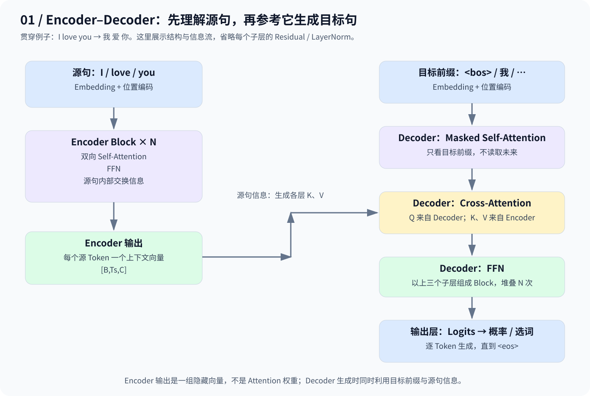
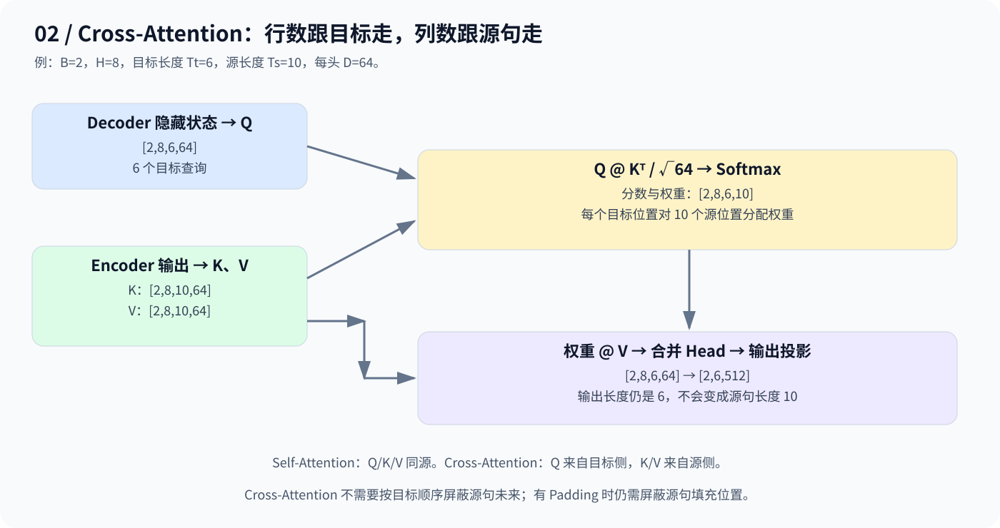
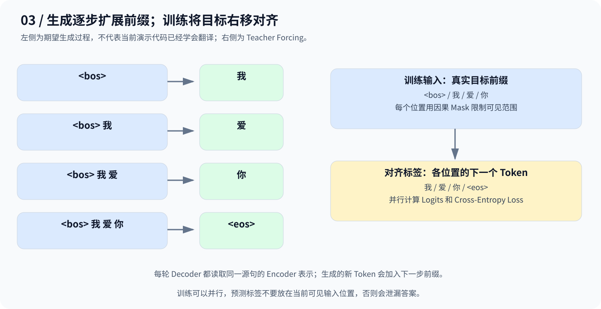

# Day 9：Encoder–Decoder——理解源句，再生成目标句

> 贯穿例子：`I love you → 我 爱 你`。Encoder 提供源句表示，Decoder 通过 Cross-Attention 读取它。

## 1. 从翻译任务理解两部分的分工

Encoder 先读取 `I / love / you`，为每个源 Token 生成融合上下文的向量。例如 `love` 的表示可以结合前后的 `I`、`you`。

Decoder 根据目标前缀和源句表示预测下一 Token：只有 `我` 还不足以确定接下来该说什么，因此需要回头读取英文源句。这就是 **Cross-Attention（交叉注意力）** 的动机。



| 模块 | 子层顺序 | 信息范围 |
|---|---|---|
| Encoder Block | Self-Attention → FFN | 源句内部双向关注，无因果限制 |
| Decoder Block | Masked Self-Attention → Cross-Attention → FFN | 先读取目标前缀，再查询源句 |

每个子层还配有 Residual 和 LayerNorm，多个 Block 堆叠。**原论文采用 Post-LN；仓库的教学实现延续 Day 8 的 Pre-LN，讲解的是相同的 Encoder–Decoder 主结构，并非逐项复刻原论文。**

## 2. 三种 Attention，主要区别在 Q/K/V 的来源

| Attention | Q 来源 | K、V 来源 | 因果 Mask |
|---|---|---|---|
| Encoder Self-Attention | 当前 Encoder 层输入 | 同一输入 | 不使用 |
| Decoder Self-Attention | 当前 Decoder 层输入 | 同一输入 | 使用 |
| Decoder Cross-Attention | 经过目标侧 Self-Attention 的隐藏状态 | Encoder 最终输出 | 通常不使用 |

“不使用因果 Mask”不代表完全不需要 Mask：存在 Padding 时，仍需屏蔽填充位置。当前演示样本等长，代码未实现 Padding Mask。

对 Cross-Attention：

$$
Q=H_{\mathrm{dec}}W_Q,\qquad
K=H_{\mathrm{enc}}W_K,\qquad
V=H_{\mathrm{enc}}W_V
$$

$$
\mathrm{CrossAttention}(Q,K,V)
=\mathrm{softmax}\left(\frac{QK^\top}{\sqrt{d_k}}\right)V
$$

计算方式与 Self-Attention 相同，区别是查询和被查询的信息来自不同序列。本次 Pre-LN 代码会先归一化目标侧隐藏状态，再生成 Q。

## 3. Cross-Attention 的分数矩阵不一定是方阵

假设源句长度 10、目标长度 6：



```text
Q：          [2,8,6,64]
K、V：       [2,8,10,64]
QKᵀ / √64： [2,8,6,10]
权重 × V：   [2,8,6,64]
合并头并投影：[2,6,512]
```

**行是目标 Query，列是源 Key，输出长度跟 Query 走。** Softmax 沿源位置的最后一维计算。

还要分清：Encoder 最终输出是 `[B,Ts,C]` 的隐藏向量；Encoder 某层的注意力权重则为 `[B,H,Ts,Ts]`。Cross-Attention 读取前者来生成 K、V，不是直接读取后者。

## 4. 生成与训练：前缀扩展，标签错开一位



期望生成过程：`<bos> → 我 → 爱 → 你 → <eos>`。其中 `<bos>` 表示开始、`<eos>` 表示结束，每一步都结合目标前缀和 Encoder 信息。

训练时使用真实目标构造 Teacher Forcing：

```text
Decoder 输入：<bos> 我 爱 你
对应标签：     我   爱 你 <eos>
```

各位置可并行预测，但目标侧因果 Mask 阻止读取未来。生成时后续 Token 尚未知，需要逐步加入新预测的 Token。

输出层给出 **Logits**（词表上的原始分数）；需要概率时再做 Softmax。训练中的 `F.cross_entropy` 直接接收 Logits，无需事先 Softmax。

## 5. 对应已有代码：一套 Attention，三种调用

[code.py](code.py) 保留已归档的完整实现，不将材料中挤在一行的结构片段替换进去。通用接口为 `MultiHeadAttention(query, key_value, causal=False)`：

```python
# Encoder：同源，不限制未来
self.self_attn(h, h)

# Decoder：同源，限制未来
self.self_attn(h, h, causal=True)

# Cross-Attention：目标提供 Q，源句提供 K、V
self.cross_attn(self.ln2(x), encoder_output, causal=False)
```

本脚本使用两条各 10 个词的英文句子互为源与目标，只测试计算流程；**它没有训练出英文到中文的翻译能力，也未实现自回归生成循环。**

| 代码部分 | 本例行为 / Shape |
|---|---|
| Embedding + 正弦位置编码 | 源与目标共享词表、Embedding；位置编码最大长度 128 |
| Encoder / Decoder 堆叠 | 各 2 层，C=512，8 个 Head |
| 源输入 | `[2,10]` |
| Decoder 输入与标签 | 加入开始 / 结束标记后均为 `[2,11]` |
| Logits | `[2,11,19]`，词表包含 17 个普通词和 2 个特殊 Token |
| 最后一层 Decoder 自注意力权重 | `[2,8,11,11]` |
| 最后一层 Cross-Attention 权重 | `[2,8,11,10]` |

脚本包含交叉熵、反向传播和一次 `AdamW.step()`，并断言未来权重为 0、Cross-Attention 查询投影收到梯度。

从仓库根目录运行（需安装 PyTorch）：

```bash
python day09/code.py
```

当前整理环境未安装 PyTorch，已检查现有代码的语法与静态数据流，以上 Shape 为根据代码推导的结果，未声称完成运行验证。

## 6. 与 GPT 的区别

| 架构 | 主要信息路径 | 常见用途 |
|---|---|---|
| Encoder-only | 输入内部双向 Self-Attention | 文本表示、分类 |
| Encoder–Decoder | 源句编码 + 目标因果注意力 + Cross-Attention | 翻译、摘要 |
| 标准 GPT 式 Decoder-only | 提示与输出放在同一序列，用因果 Self-Attention | 文本生成 |

**原版 Transformer 的 Decoder 既看目标前缀，也通过 Cross-Attention 读取源句；标准 GPT 不包含独立 Encoder 或这条交叉注意力支路。**

---

[返回学习导航](../README.md)
