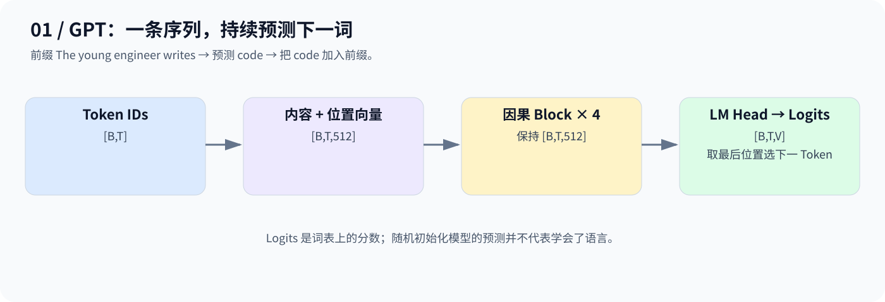
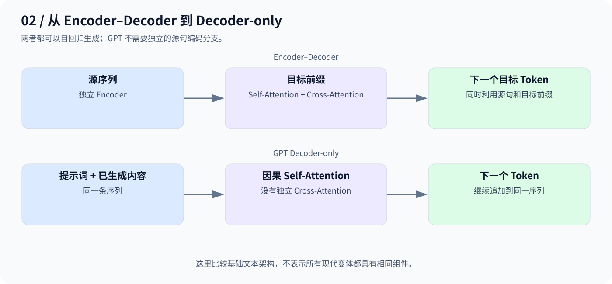

# Day 10：GPT——把提示和输出放进同一条序列

> 从 `The young engineer writes → code` 理解 Decoder-only 与下一个 Token 预测。

## 1. 先看前缀如何增长

| 当前前缀 | 期望下一个 Token |
|---|---|
| The | young |
| The young | engineer |
| The young engineer | writes |
| The young engineer writes | code |

选出的新 Token 会追加到原序列，再预测下一个。这是**自回归生成**；表格只是期望示例，不代表随机模型能生成正确文本。



## 2. 从 Encoder–Decoder 到 Decoder-only

原版 Transformer 的 Decoder 会通过 Cross-Attention 读取独立 Encoder 的输出。基础 GPT 则把提示词和已生成内容放在同一序列，使用因果 Self-Attention，不再设置这两条独立分支。



这不是把一个训练好的原版模型简单删掉几层就得到 GPT，而是采用 Decoder-only 的结构设计。

## 3. Next-Token Prediction 与 Logits

$$
P(x_{t+1}\mid x_1,\ldots,x_t)
=\mathrm{softmax}(z_t)
$$

`z_t` 是位置 t 对整个词表的分数向量。输入 `[B,T]` 经过 Embedding 和 Block 后为 `[B,T,C]`，LM Head 映射成 `[B,T,V]` 的 **Logits**，并不是 Token ID。

生成时取 `logits[:, -1, :]`，经贪心选择或采样得到下一个 ID。预测 `writes` 的位置只能读取 `The young engineer`，不能读取输入里后面的 `writes` 本身，更不能读取 `code`；因果 Mask 防止目标泄漏。

## 4. 本日代码

[code.py](code.py) 将聊天中的 MiniGPT 主体和形状演示，与现有 Attention、FFN、Block 合并。位置方案按聊天采用可学习 Embedding；Block 返回 `(x, weights)`，主体相应解包为 `x, _`。

| 配置 | 值 |
|---|---|
| 词表 / 隐藏维度 | 10000 / 512 |
| Block / Head 数 | 4 / 8 |
| 最大位置长度 | 128 |
| 输入与预期 Logits | `[2,10]` → `[2,10,10000]` |

```bash
python day10/code.py
```

这里只验证前向链路并选择一个随机初始化模型的预测 ID，没有训练和完整生成循环。已检查语法与模块接口；当前环境未安装 PyTorch，未运行脚本。

**主线：Token IDs → 内容与位置向量 → 因果 Blocks → LM Head → Logits。**

---

[返回学习导航](../README.md)
