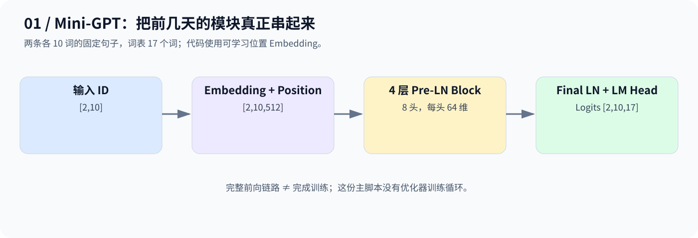
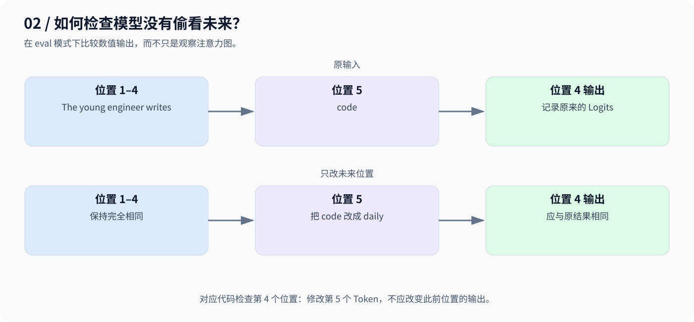

# Day 11：从零写 Mini-GPT——把模块串成完整前向链路

## 1. 从两条固定句子开始

> The young engineer writes code and solves difficult problems daily
>
> The experienced developer reviews code and improves the system performance

代码按词建立 17 个词的词表，把两句各 10 个 Token 转成 `[2,10]` 的 ID 张量，再送进自己实现的 GPT。这里是教学分词，并非真实大模型的子词分词器。



## 2. 模块各做什么？

| 模块 | 作用 |
|---|---|
| Token Embedding | ID 查表，得到 512 维内容向量 |
| 可学习位置 Embedding | 与内容相加，提供位置线索 |
| 4 个 Pre-LN Block | 因果注意力交换信息，GELU FFN 加工特征 |
| Final LayerNorm | 最后规范化隐藏特征 |
| LM Head | 512 维映射到词表 17 个候选分数 |

$$
\mathrm{Logits}=\mathrm{LN}(\mathrm{Blocks}(E+P))W_{\mathrm{LM}}
$$

每个 Block 内是 `x + Attention(LN(x))`，再执行 `h + FFN(LN(h))`。最终输出 `[2,10,17]`，每个位置都预测它后面的 Token。

## 3. 如何证明没有偷看未来？

代码将第 5 个词 `code` 改成 `daily`，比较修改前后第 4 个位置的 Logits：因果模型的此前输出应不受影响。



这是数值一致性检查，不是在断言模型已经理解句子。

## 4. 对应代码与练习

- [code.py](code.py)：完整组件、前向计算、参数统计、下一词预测和因果性断言。
- [day11Test.py](day11Test.py)：此前归档的额外训练练习，与主脚本独立运行。

```bash
python day11/code.py
python day11/day11Test.py
```

主脚本没有训练循环，随机初始化时输出的词没有语言能力保证。附加训练练习会耗时。原代码开头的注释将头数写成 10，与实际 `num_heads=8` 不同；实际配置为准，512 也不能按该配置均分成 10 头。

本篇按已归档代码整理，代码保持原样；语法与静态维度已检查，当前环境未安装 PyTorch，未实际运行。

**完整模型结构不等于训练好的模型：先打通前向，再学习如何更新参数。**

---

[返回学习导航](../README.md)
