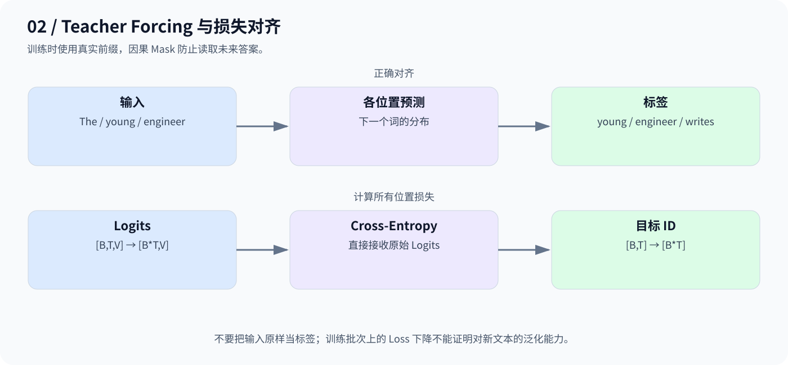
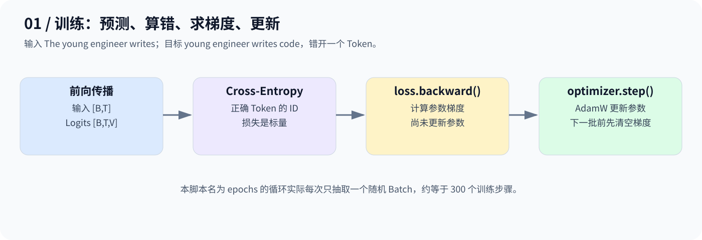

# Day 12：Mini-GPT 怎么训练——让预测误差推动参数更新

## 1. 用一句话构造输入和答案

```text
文本：The young engineer writes code
输入：The young engineer writes
目标：young engineer writes code
```

输入与目标错开一个 Token。训练时使用真实前缀叫 **Teacher Forcing**；因果 Mask 防止当前位置读取未来标签。



## 2. 什么叫“预测错了”？

假设正确目标是 `code`：预测它的概率为 0.8 时，单位置损失约 0.223；只有 0.1 时，损失约 2.303。正确词的概率越低，惩罚越大。

$$
\mathcal{L}=-\frac{1}{BT}\sum_{b,t}\log p_\theta(y_{b,t}\mid x_{b,\le t})
$$

这就是本例所有位置平均的交叉熵。`F.cross_entropy` 接收 Logits 和整数目标，内部完成所需计算，不要先手工 Softmax。

## 3. 梯度与更新是两步



```python
optimizer.zero_grad()
logits = model(x)
loss = F.cross_entropy(logits.reshape(-1, vocab_size), y.reshape(-1))
loss.backward()
optimizer.step()
```

`backward()` 计算梯度；`step()` 才更新参数。下一步清空旧梯度，避免无意累积。

## 4. 本日代码的实际设置

[code.py](code.py) 用两条固定句子加额外英文短句组成小语料，各句后加 `<eos>`，随机抽取连续 Token 窗口。使用 128 维、4 头、2 层 MiniGPT，窗口 16、Batch 16，AdamW 学习率 `1e-3`。

代码变量叫 `epochs=300`，但每轮只抽取一个 Batch，实际更接近 300 个更新步骤，不是遍历全部数据 300 遍。

脚本比较固定批次训练前后的 Loss、预测准确率，并做未来 Token 扰动检查。该批次来自同一训练语料，**不能用它证明泛化能力**；应另留验证集。原代码未保存训练前的参数副本，因此没有直接对比参数数值是否变化。

```bash
python day12/code.py
```

本篇依据已归档代码整理并保留原实现；已检查语法和损失对齐，当前环境未安装 PyTorch，未实际执行训练。

**训练的核心是：正确对齐目标，让损失经过梯度和优化器更新可学习参数。**

---

[返回学习导航](../README.md)
