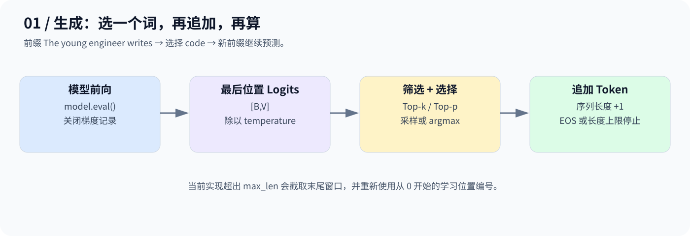
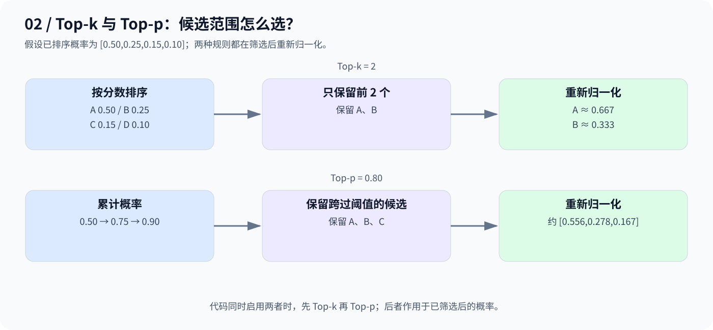

# Day 13：文本生成——从分数中选一个 Token

## 1. 从 writes 后面接什么开始

输入 `The young engineer writes`，模型为词表中的每个 Token 给出分数。选出 `code` 后，将它追加回前缀，再预测下一个 Token。



这是期望示例，不保证小语料模型每次都生成该词；生成质量来自训练，采样参数只是改变选词方式。

## 2. Temperature：调整分布尖锐程度

$$
p_i=\mathrm{softmax}(z_i/\tau),\qquad\tau>0
$$

例如 Logits `[2,1,0]`：温度 1 时概率约 `[0.665,0.245,0.090]`；温度 0.5 时约 `[0.867,0.117,0.016]`。

温度降低时更偏向高分候选，提高时更平缓。正温度不改变候选排序，因此不改变纯 `argmax` 的选择；随机采样的结果则会受到分布影响。

## 3. Top-k 与 Top-p：缩小候选池



- **Top-k**：只保留分数最高的 k 个候选；代码用阈值筛选，遇到并列分数时可能保留更多。
- **Top-p（核采样）**：按概率降序累计，保留达到阈值 p 所需的候选，包括跨过阈值的第一个 Token。
- **采样**：筛选后重新归一化，用 `torch.multinomial` 抽取。
- **贪心**：用 `argmax` 选最高分，不进行随机抽样。

当前代码的顺序是 Temperature → Top-k → Top-p。同时启用时，Top-p 对已经 Top-k 筛选后的分布计算。

## 4. 本日代码与限制

[code.py](code.py) 先训练小型 MiniGPT，再调用 `generate()`，设置温度 `0.8`、Top-k `5`、Top-p `0.9`，最多生成 12 个新 Token。

关键操作：`logits[:, -1, :]` 取末位置分数；`torch.cat(..., dim=1)` 追加 Token；`eval()` 配合 `@torch.no_grad()` 关闭训练行为与梯度记录。

超过最大长度时，本实现截取最后 `max_len` 个 Token，并重新从位置 0 编号，是教学滑窗近似。生成遇到 `<eos>` 或步数上限停止。Batch 停止逻辑只检查“当前这一步是否全部为 EOS”，没有逐样本维护完成状态，演示用单样本即可。

```bash
python day13/code.py
```

本篇依据原代码整理，保留原实现；数学示例已核对，代码语法已检查。当前环境未安装 PyTorch，未实际运行训练与生成。

**模型给分数，解码策略选 Token，然后把选择追加回上下文。**

---

[返回学习导航](../README.md)
