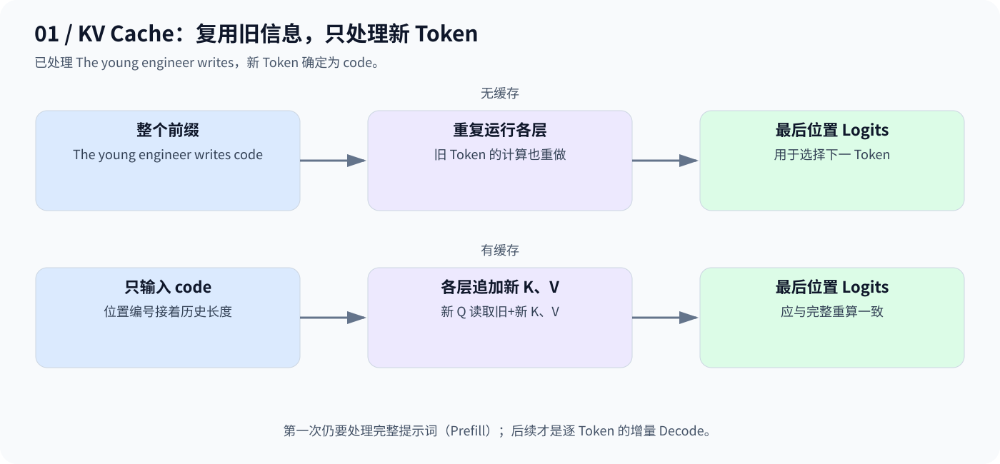
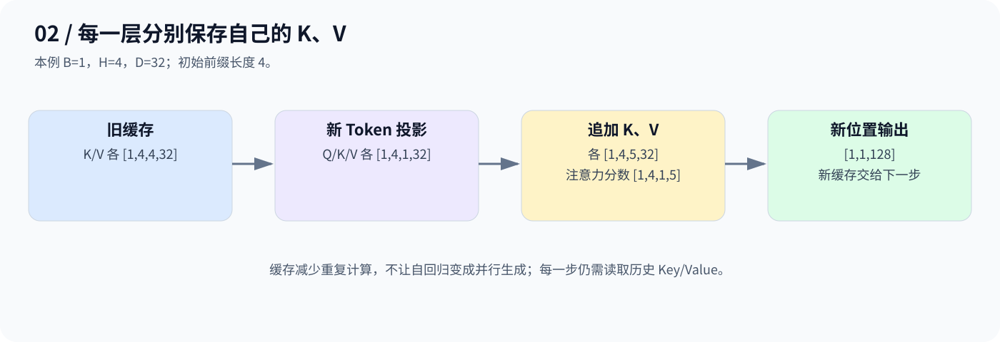

# Day 14：KV Cache——不重复计算历史 Token

## 1. 用同一个生成过程看重复工作

已经处理 `The young engineer writes`，新 Token 确定为 `code`。不使用缓存时，下一轮通常把整个前缀再算一次；使用缓存时，只输入 `code`，复用各层历史 K/V。



首次处理整个提示叫 **Prefill**，之后逐 Token 的增量计算叫 **Decode**。缓存的是每层自己的 Key、Value，不是模型参数，也不是最终文本。

## 2. 为什么只缓存 K、V？

新位置的 Q 需要匹配历史 K，再汇总历史 V；过去位置的 Q 不用于计算新位置的输出，因此通常无需保存。

在因果模型、固定位置和相同前缀条件下，过去 Token 的隐藏表示不依赖未来，可以复用。应在推理模式下使用，并确保位置编号与缓存长度一致。



```text
旧 K/V：[B,H,L,D]
新 K/V：[B,H,1,D]
追加后：[B,H,L+1,D]
新 Q：  [B,H,1,D] → 分数 [B,H,1,L+1]
```

单 Token 增量时，K/V 中只有过去和当前位置，没有未来，不必再套一个从零开始的方阵因果 Mask。若一次追加多个 Token，则必须按历史偏移正确构造 Mask。

## 3. 省计算，但占内存

对于标准 MHA，若每层 K、V 同维度，缓存大小约为：

$$
\mathrm{bytes}=2\,N_{\mathrm{layers}}BHTD\,s
$$

其中 s 是每个元素的字节数。长度 T 增大，缓存线性增长；新 Q 仍需关注所有历史位置，因此缓存不会让每步注意力成本变成常数，也不会把自回归生成变成一次并行输出。

## 4. 本日代码验证什么？

[code.py](code.py) 实现逐层 `past_key_values`；Prefill 返回缓存，之后只送入新 Token。配置是 128 维、4 头、2 层、最大位置 32，并先训练一个小模型。

代码用相同权重和输入比较：

1. 完整提示与缓存 Prefill 的末位置 Logits。
2. 完整前缀追加 `code` 后重算，与单 Token 缓存计算的 Logits。

两个比较均用 `torch.allclose`，是正确性检查，不是性能基准。缓存解码分支要求有历史时每次只输入一个新 Token。

```bash
python day14/code.py
```

脚本会生成并保存 `day14_minigpt.pt`；权重已被仓库忽略规则排除。缓存版没有滑动窗口或自动淘汰，长度超过 `max_len=32` 会触发断言，不应靠只截断缓存就宣称结果仍等价。

本篇依据已归档代码整理并保留原实现；当前环境未安装 PyTorch，未执行训练或缓存一致性断言。

**缓存复用过去的 K/V，新 Token 的 Q 继续读取历史信息。**

---

[返回学习导航](../README.md)
