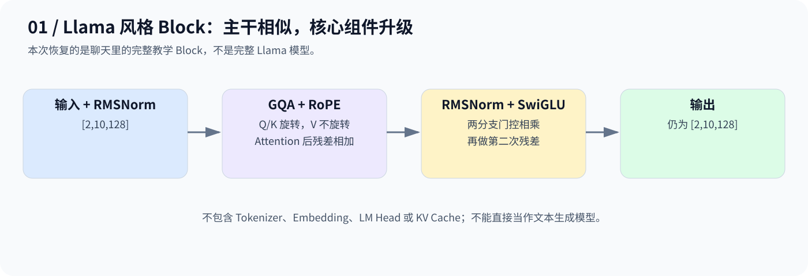
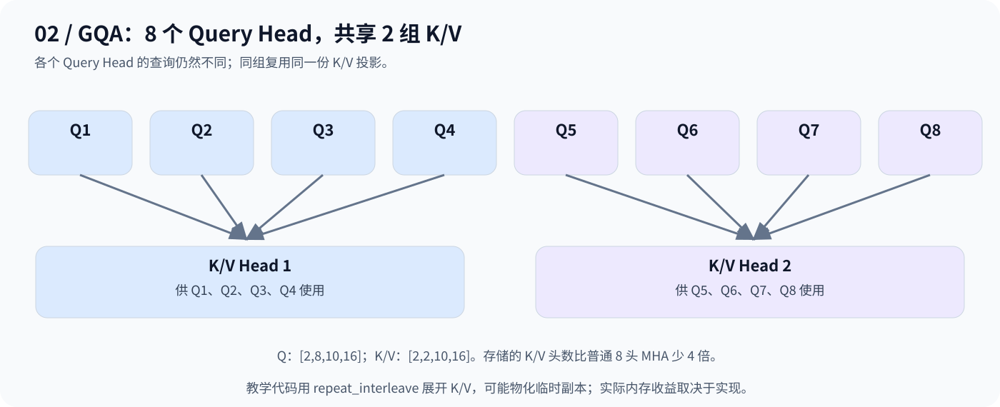

# Day 15：Llama 风格 Block——四个组件怎样升级

## 1. 从 MiniGPT 的同一条主干出发

仍然输入两条各 10 个 Token 的表示，形状为 `[2,10,128]`。Block 继续采用“归一化 → 注意力 → 残差，再归一化 → FFN → 残差”，但替换内部组件。



| 组件 | 本日变化 |
|---|---|
| 归一化 | LayerNorm → RMSNorm |
| 位置信息 | 对 Q、K 使用 RoPE |
| FFN | 普通非线性 FFN → SwiGLU |
| 注意力头 | Q 头较多，K/V 头较少，采用 GQA |

这是一份组合这些组件的教学 Block；不同 Llama 版本、规模的配置并不完全相同。

## 2. RMSNorm：不减均值，按均方根缩放

例如 `[2,0,4,2]` 的均方为 6，忽略 ε 后除以 `√6` 得到约 `[0.8165,0,1.6330,0.8165]`，再乘可学习权重。

$$
\mathrm{RMSNorm}(x)=\gamma\odot\frac{x}{\sqrt{\frac{1}{C}\sum_i x_i^2+\epsilon}}
$$

与 LayerNorm 不同，它不减均值；本代码也没有偏移 β。输出不必零均值。

## 3. RoPE：旋转 Q、K，让分数体现相对位置

二维向量 `[1,0]` 旋转 90° 会变成 `[0,1]`；RoPE 对不同特征对使用不同频率，按位置旋转 Q/K。相同频率下，两位置旋转向量的点积由相对位置差影响。

$$
(R_mq)^\top(R_nk)=q^\top R_{n-m}k
$$

本实现不旋转 V，不给 Embedding 直接加位置向量。代码按前后两半配对旋转：第 j 维与第 `j+D/2` 维配对，不是按相邻两维配对；不同布局需与权重约定匹配。

## 4. SwiGLU：一条分支产生特征，另一条控制通过多少

可以把门控理解为调节旋钮，但它不一定限制在 0～1。两条投影分支逐元素相乘，再投影回模型维度：

$$
\mathrm{SwiGLU}(x)=\bigl(\mathrm{SiLU}(xW_g)\odot xW_u\bigr)W_d
$$

本例两条分支均是 `128→352`，相乘仍为 352 维，再通过 `352→128` 恢复原维度。

## 5. GQA：更多查询，共享较少的 K/V



配置为 `8` 个 Q Head、`2` 个 KV Head，每头 `16` 维：Q 是 `[2,8,10,16]`，K/V 各为 `[2,2,10,16]`。四个 Query Head 共享一组 K/V，但各自计算注意力权重。

同样长度下，K/V 的存储头数相较 8 头 MHA 少 4 倍，有助于降低缓存负担。教学代码为方便计算，用 `repeat_interleave` 将 K/V 展开到 8 头，可能产生临时副本；不能因此声称实际峰值内存也必然下降 4 倍。

## 6. 代码与边界

[code.py](code.py) 从所引用聊天的 Day 15 完整代码恢复，包括 `RMSNorm`、`apply_rope`、`GQAAttention`、`SwiGLU`、`LlamaBlock`，并测试随机输入的前向与梯度。

```bash
python day15/code.py
```

输入输出预期均为 `[2,10,128]`，按参数定义静态计算共 `176384` 个参数。脚本打印 Q 投影是否有梯度，但没有优化器更新、完整模型训练、Tokenizer、LM Head 或 KV Cache。

代码语法、公式和数值例子已检查；当前环境未安装 PyTorch，未实际运行。聊天明确表示 Day 16 尚未正式开始，因此不把进阶课程写成已完成内容。

**主干仍是 Transformer Block；升级发生在位置、归一化、门控与 K/V 共享方式上。**

---

[返回学习导航](../README.md)
